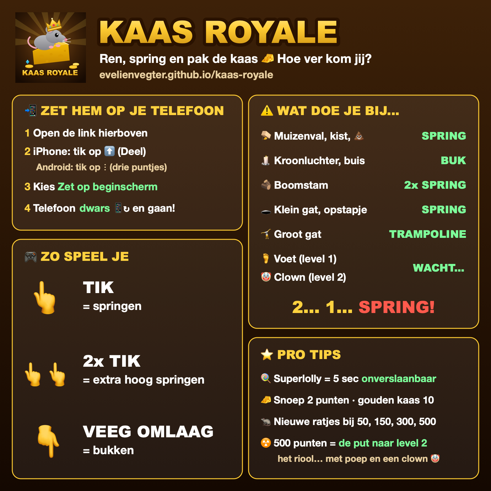

# Kaas Royale 🧀🐀

Een ratje rent door een schatkamer vol lekkers. Gemaakt voor de telefoon (houd hem dwars).

**Spelen:** https://evelienvegter.github.io/kaas-royale/

## Besturing

- Tik: springen
- 2x tikken: hoger springen
- Veeg omlaag: bukken (onder de kroonluchter door)
- Op de computer: spatie of pijltje omhoog springt, pijltje omlaag bukt

## In het spel

- Lekkers pakken: elk snoepje is 2 punten, gouden kaas is 10 punten
- 🍭 Superlolly: 5 seconden superkracht (sneller, dwars door alles, dubbele punten)
- Muizenvallen en schatkisten: springen
- Kroonluchters: bukken
- Boomstam: 2x springen
- Kleine gaten: springen; grote gaten: via de trampoline
- Opstapjes in de vloer: springen
- In level 1 komt elke 14 seconden de grote voet, in level 2 de clown met de rode ballon. Het spel telt af (2, 1, SPRING!): spring dan
- Nieuwe ratjes vrijspelen bij 50, 150, 300 en 500 punten (Radio, de radioactieve rat)
- Level 1 is de schatkamer. Bij 500 punten komt de put: daar val je in level 2, het riool
  (met poep, wc-papier, rioolbuizen en groen rioolwater in de gaten)
- Heb je level 2 een keer gehaald, dan krijgt het beginscherm een tweede slide: veeg opzij en tik op je ratje om meteen in level 2 te beginnen
- In level 2 beginnen de punten opnieuw, met een eigen record. Bij 150 punten in level 2 speel je de Poeprat vrij (bruin, met een drolletje op zijn hoofd)
- Bij 500 punten in level 2 komt de pijp: daar schiet je omhoog naar level 3, de keuken (messen, peper en zout, koekenpannen,
  een soeppan, gasfornuizen, een spons als trampoline en de kat). Bij 150 punten in level 3 speel je Chef vrij, met een koksmuts

## Zelf aanpassen

Alles staat in `index.html`. Bovenaan staan `INSTELLINGEN`, `RATJES` en `LEKKERS`: verander een getal, sla op en
vernieuw de pagina.
